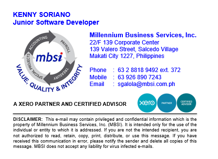

# Welcome to My GitHub Profile

> This GitHub account is used for authorized MBSI work, internal projects, training, and technical documentation.

---

### 🏢 About This Account

I use this account to support my work at **Millennium Business Services, Inc. (MBSI)**. It contains project code, development updates, and guides that help with website maintenance, internal tools, and team collaboration.

### 📋 What I Work On

- **Company Projects:** Build, improve, and maintain websites and tools for approved MBSI projects.
- **Training:** Learn and practice technical skills relevant to my role.
- **Documentation:** Write setup instructions, troubleshooting guides, and project notes for future reference and team handover.

### 🔒 Privacy and Security

- Passwords, access keys, personal information, and confidential company records should not be uploaded.
- Project files should be reviewed before they are shared.
- Access to private projects should be limited to authorized people.

### 📝 Ownership and Contributions

My work includes adding features, fixing issues, and maintaining existing projects. I do not claim ownership of all code or materials in these repositories.

MBSI branding and company materials, third-party software, and other resources remain subject to their owners’ rights and applicable licenses. My contributions do not replace those ownership or license terms.

### 📧 Contact

For questions about my contributions or authorized MBSI projects:

**Email:** [ksoriano@mbsi2.com.ph](mailto:ksoriano@mbsi2.com.ph)

---

  

